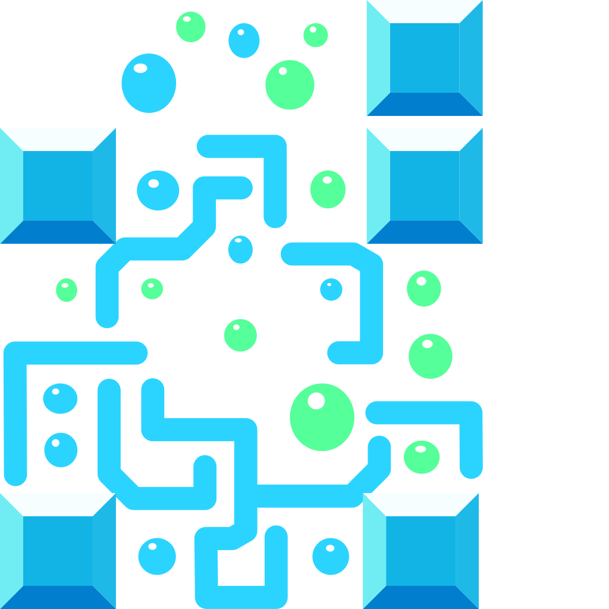

<div align="center">



# Quantris

</div>

Tetris where every block is a quantum gate. Pieces fall onto a circuit of eight qubit wires.
Build the state the objective asks for, then measure it when you are sure.

Video demonstration (of an earlier version): https://www.youtube.com/watch?v=_Uonyu2nNHg

## Controls

+ Up/Down: move the piece up or down a wire
+ Left (hold): fall faster
+ Right: drop the piece
+ X/Z: rotate clockwise/counterclockwise
+ C: hold the piece, swapping with the held one (once per piece)
+ Space: measure
+ R: restart

## Rules

+ Objective: the measured wires (marked by the icons at their right end, counted up from the
  bottom) must show the objective's outcome probabilities exactly, phases ignored.
+ Measuring: press Space to grade the locked circuit. Success scores 10 points per block, clears
  the board and draws the next objective. Failure costs nothing but the cooldown; the icons fade
  back in as it runs out.
+ Clearing columns: a column with a gate on every wire clears for 100, 300, 500 or 800 points for
  one to four columns at once, and the columns to its right slide left.
+ Falling: pieces step one column left every second, or five times a second while Left is held.
+ Rotation: standard SRS tetromino rotations with wall kicks, transposed so gravity points left.
+ Losing: a piece that locks while still past the right edge.
+ Pieces: a random tetromino carrying random X, Y, Z and H gates, with one cell (none on the I)
  holding a control or anti-control, 50/50, that conditions the gate next to it.

## Architecture

+ `src/quantum.rs`: the state-vector simulation (gates, controlled gates, outcome
  probabilities). Pure Rust with unit tests; it knows nothing about Bevy.
+ `src/board.rs`: every placed gate is one `Block` entity that lives until it is cleared; there is
  no array of cells. `Grid` is an occupancy snapshot built from the blocks whenever a system needs
  collision checks or whole-column logic. Also column clearing and collapsing.
+ `src/piece.rs`: a `Tetromino` is a shape plus its four gates; SRS tables, spawning, holding,
  steering, gravity and locking. The only difference between a falling and a locked block is the
  `Falling` component.
+ `src/objective.rs`: the objectives, the circuit evaluation, the measure key and its cooldown.
+ `src/ui.rs`: labels, the game-over screen, restarting.
+ `src/main.rs`: app wiring. Each frame runs, in order: restart, spawn, hold, steer, fall, hard
  drop, measure, clear full columns, collapse empty columns, check for game over; then the labels
  and block transforms (only for blocks that moved).
+ Restarting is just re-entering the `Playing` state: blocks carry `DespawnOnEnter(Playing)`,
  and the enter schedule resets the score, piece, hold and cooldown.

## Quantum simulation

+ The eight wires are a 256-amplitude state vector starting in |00000000⟩; wire `y` is bit `y` of
  the basis-state index.
+ A column's gates act on distinct wires, so they are applied one at a time directly to the
  vector, costing O(2ⁿ) per gate. A control contributes no gate of its own; it conditions the gate
  on the wire it points at on its own wire being |1⟩ (|0⟩ for an anti-control).
+ Measuring reads the joint outcome distribution of the measured wires and compares it with the
  objective's target probabilities within a small tolerance.

## Developing

```
cargo run
cargo test
```
